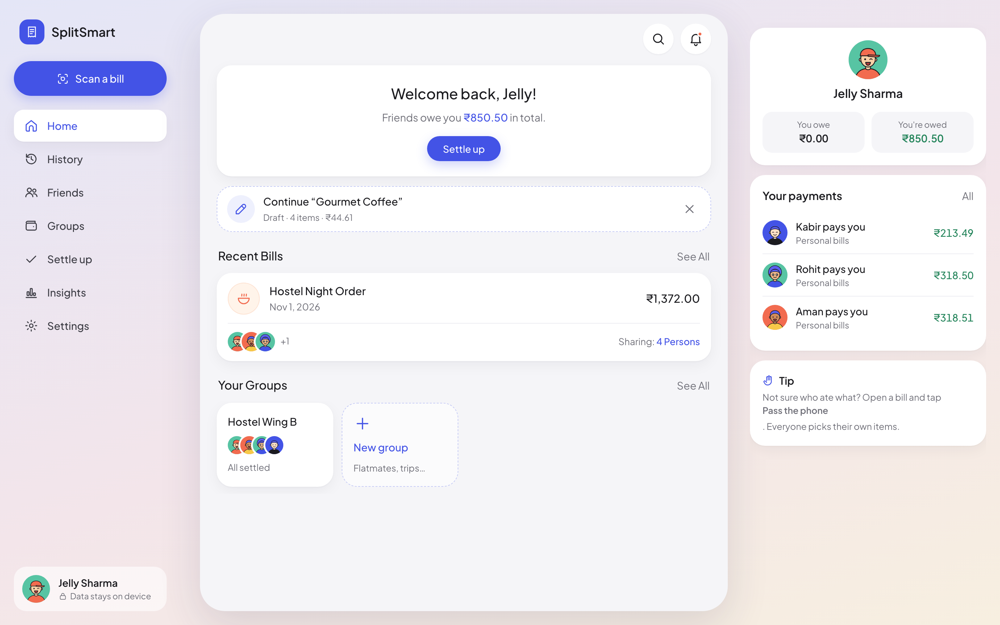

# SplitSmart

Scan a bill, pay only for what you had, and settle up without the awkward group chat. A mobile-first, client-side web app: receipts are read on the device, data stays in the browser, and there is no backend.

## Run locally

Requires Node.js 18+ for tests. Serve `dist/` with any static server (`npx serve dist` or `python3 -m http.server 8000 --directory dist`) and open the URL. HTTPS or localhost is needed for the camera, service worker and install prompt. `npm test` runs the engine, parser, sharing and storage tests. No build step or API key.

## How it works

1. **Onboarding:** your name, an illustrated avatar (or a photo), food preferences (veg, no egg, no alcohol), an optional UPI ID and your usual crew.
2. **Scan:** camera with a receipt frame, or a gallery photo, pasted text, or manual entry. Rotate, crop and enhance before reading. Printed receipts and Swiggy/Zomato screenshots are both understood.
3. **Recognized Items:** edit names, quantities and line prices; taxes, fees and discounts are listed separately; a live check compares the items against the receipt total.
4. **Split:** pick who was there, then who had each item. Diet tags leave people out of matching items automatically (with an Include override). Items with a quantity can be split by count. Unsure who ate what? **Pass the phone** and everyone taps their own items.
5. **Summary:** each person's items and every fee as a separate line, disputed items, rounding, split method, group and category. Save the bill, copy a link, or share.
6. **Settle up:** the fewest payments across each group and your personal bills, with UPI links and QR codes. Payments are recorded only when marked paid.

## Fairness rules

Money is computed in integer paise and every split adds up exactly to the bill total (largest-remainder allocation).

| Situation | Rule |
|---|---|
| Item shared by some people | Split equally among those who had it |
| Split by count (e.g. 3 of 6 rotis) | Charged per unit; unclaimed units are split equally among everyone |
| Nobody claimed an item | Split equally among everyone on the bill |
| Delivery, packaging, platform fees | Equally among people who ordered something |
| Tax, service charge, tip, discounts | In proportion to what each person ordered |
| Split Tax off | The payer covers the tax |
| Coupon owner | A discount can be credited to one person |
| Disputed item | Held with the payer until someone claims it |
| Receipt total differs from items | Difference shared in proportion, shown as an adjustment |
| Rounding to ₹1/₹5/₹10 | Everyone else is rounded; the payer absorbs the difference |

Settlement uses a backtracking search for the minimum number of payments, preferring the answer that moves the least money. Tiny payments can be hidden.

## Sharing

A shared link carries the whole bill, compressed into the URL, so no server is needed. Friends see a read-only breakdown and can save it to their own SplitSmart; they choose which person they are.

## Data and robustness

- Data lives in `localStorage` (`splitsmart-v2`). Data from the previous version is migrated on first launch with identical splits; the old copy is kept.
- Corrupted storage never crashes the app: the raw data is kept aside and can be downloaded.
- Deletes and edits offer Undo; destructive actions ask first. Backups are JSON; bills export as CSV; imports are validated.
- A full-storage error is reported instead of silently losing a change.
- The camera, OCR model (Tesseract.js) and QR library download on first use; after that the app works offline. Optional category suggestions use `Xenova/mobilebert-uncased-mnli` via Transformers.js. No model is trained.

## Code map

`dist/core.js` money and settlement · `fair.js` fair-split engine · `parse.js` receipt and food-app parser · `share.js` links · `store.js` storage, migration, recurrence · `model.js` domain helpers · `ui.js`, `icons.js`, `avatar.js` UI kit · `views/` screens · `app.js` router and shell.

Verified in the browser at 360, 768, 1024 and 1440 px with no horizontal overflow, including real OCR of a test receipt.
